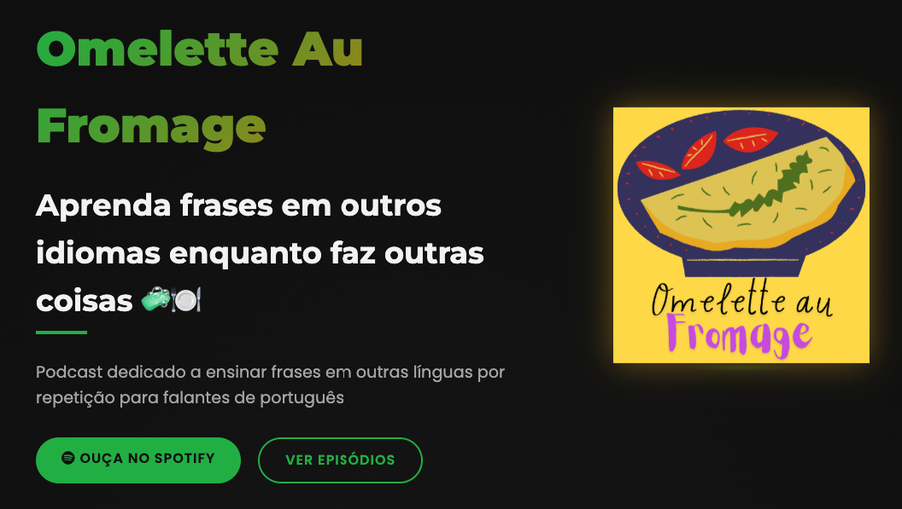

---
sidebar_custom_props:
  icon: 🧀
  description: Podcast para aprender frases em outros idiomas por repetição.
---

# Podcast - Omelette Au Fromage

:::info
Acesse em https://ltmleo.github.io/omeletteaufromage/
:::

[](https://ltmleo.github.io/omeletteaufromage/)

Podcast dedicado a ensinar frases em outras línguas por repetição para falantes de português.

Omelette Au Fromage é um podcast dedicado a ensinar frases em outras línguas por repetição para falantes de português.

A ideia surgiu do episódio de Laboratório de Dexter, em que o Dexter para passar em uma prova de francês, constrói uma máquina capaz de ensinar francês enquanto ele dorme, porém o disco trava e ele só consegue falar "Omelette Du Fromage", o correto seria "Omelette Au Fromage", que dá nome ao nosso podcast.

<iframe width="560" height="315" src="https://www.youtube.com/embed/2kArCRjT29w?si=1zMW18-kWR0I6Xty" title="YouTube video player" frameborder="0" allow="accelerometer; autoplay; clipboard-write; encrypted-media; gyroscope; picture-in-picture; web-share" referrerpolicy="strict-origin-when-cross-origin" allowfullscreen></iframe>

Os áudios são cuidadosamente gerados por IA para oferecer a melhor experiência de aprendizado possível.

## Linguas

- Holandês 🇳🇱
- Italiano 🇮🇹
- Espanhol 🇪🇸
- Francês 🇫🇷

## Temas

Nosso método de aprendizado baseia-se na repetição estratégica de frases úteis em idiomas estrangeiros, focado especialmente em preparar você para situações reais de viagem. Para uma experiência de aprendizado organizada e eficiente, os episódios estão divididos nos seguintes temas essenciais:

1. Saudações
2. Restaurante
3. Compras
4. Transporte
5. Saúde
6. Perguntas Essenciais
7. Turismo
8. Palavras 1
9. Palavras 2
10. Palavras 3

## Como funciona

Para mais informações sobre como funciona o podcast, acesse nosso [site](https://ltmleo.github.io/omeletteaufromage/). Porém aqui eu gostaria de explicar um pouco mais sobre como foi desenvolver um podcast com IA e um conceito de automação que eu particularmente gosto e utilizo muito que é o "Automação por camadas".

## Text-to-Speech GCP

O [Google Cloud Text-to-Speech](https://cloud.google.com/text-to-speech?hl=en) é uma ferramenta poderosa que converte texto em fala natural, permitindo a criação de áudios de alta qualidade para diversos idiomas. Com suporte a mais de 30 idiomas e dialetos, essa tecnologia é ideal para projetos que exigem vozes realistas e expressivas.

A API oferece uma variedade de vozes, incluindo opções masculinas e femininas, além de diferentes estilos de fala, como padrão, velocidade, entonação e emoção. Isso possibilita a personalização da experiência auditiva, tornando-a mais envolvente e adaptada ao público-alvo.

No podcast, utilizamos a API do Google Cloud Text-to-Speech para gerar os áudios de forma automatizada. Através de uma simples chamada a API, conseguimos criar os episódios em diferentes idiomas, garantindo uma produção rápida e eficiente. Além disso, mudamos a velocidade para que o usário consiga acompanhar a pronúncia e a entonação de cada frase. Isso é especialmente útil para iniciantes que estão aprendendo um novo idioma e precisam de tempo para assimilar as informações.

## Automação por camadas

A automação por camadas é uma abordagem que consiste em dividir um processo complexo em etapas menores e mais gerenciáveis. Essa técnica permite que cada camada seja tratada de forma independente, facilitando a manutenção e a escalabilidade do sistema.

No caso do podcast, utilizamos a automação por camadas para gerar os episódios de forma eficiente. Cada camada representa uma etapa do processo de produção, desde a criação do conteúdo até a publicação final. Isso nos permite adicionar novos idiomas e temas facilmente, sem comprometer a qualidade do material.


### Camada 1: Geração de conteúdo

A primeira camada é responsável pela geração do conteúdo do podcast. Utilizamos um script em Python que lê os temas e frases pré-definidas, as frases são passadas por um modelo de LLM (gemini) para gerar as frases em diferentes idiomas. Essa abordagem garante que o conteúdo seja devidamente traduzido e adaptado para cada idioma, mantendo a essência das frases originais.

Entrada:

```plaintext
Água
Banheiros
Conta
Água, por favor
Onde é o restaurante mais próximo?
Onde é o banheiro?
Aceita cartão?
Pode me trazer o cardápio?
Pode me trazer a conta?
Gostaria de uma cerveja, por favor
Gostaria desse aqui, por favor
```

Saída:

```plaintext
Água
Eau
Banheiros
Toilettes
Conta
Addition
Água, por favor
Eau, s'il vous plaît.
Onde é o restaurante mais próximo?
Où est le restaurant le plus proche?
Onde é o banheiro?
Où sont les toilettes?
Aceita cartão?
Acceptez-vous la carte?
Pode me trazer o cardápio?
Menu, s'il vous plaît.
Pode me trazer a conta?
Addition, s'il vous plaît
Gostaria de uma cerveja, por favor
Je voudrais une bière, s'il vous plaît
Gostaria desse aqui, por favor
Je voudrais ça, s'il vous plaît. 
```

Assim, conseguimos revisar e ajustar o conteúdo antes de prosseguir para a próxima camada. Se eu precisar realizar alguma alteração específica, posso fazer isso nesta etapa sem afetar o restante do processo. Isso é especialmente útil para garantir que o conteúdo esteja alinhado com os objetivos do podcast e atenda às necessidades do público-alvo.

### Camada 2: Geração de script do podcast

A segunda camada é responsável pela geração do script do podcast. Utilizamos um script python que recebe o output da primeira camada e gera o script do podcast. Essa etapa é crucial para adequar as vozes de cada frase, velocidade, pausas e repetições.

Entrada:
```plaintext
Output da camada 1
```

Saída:

```yaml
music: ./assets/music.mp3
voices:
- name: pt-BR-Chirp3-HD-Charon
- name: fr-FR-Standard-A
- name: fr-FR-Standard-B
- name: fr-FR-Standard-C
- name: pt-BR-Chirp3-HD-Kore
script:
- repeat: 1
  script:
  - voice: 4
    recap: false
    text: 'Olá, esse é o episódio 2 do podcast Omelete Au Fromage, onde
      você aprende frases em outras linguas por repetição, para se virar em uma viagem
      ou qualquer outra situação. No episódio de hoje, vamos aprender algumas frases
      em francês para se virar em um restaurante. Vamos lá!'
- repeat: 1
  script:
  - text: Água
    voice: 0
  - text: Eau
    repeat:
    - rate: 0.6
      voice: 1
    - rate: 0.8
      voice: 2
    - rate: 1
      voice: 3
- repeat: 1
  script:
  - text: Banheiros
    voice: 0
  - text: Toilettes
    repeat:
    - rate: 0.6
      voice: 1
    - rate: 0.8
      voice: 2
    - rate: 1
      voice: 3
- repeat: 1
  script:
  - text: Conta
    voice: 0
  - text: Addition
    repeat:
    - rate: 0.6
      voice: 1
    - rate: 0.8
      voice: 2
    - rate: 1
      voice: 3
- repeat: 2
  script:
  - text: Água, por favor
    voice: 0
  - text: Eau, s'il vous plaît.
    repeat:
    - rate: 0.6
      voice: 1
    - rate: 0.8
      voice: 2
    - rate: 1
      voice: 3
- repeat: 2
  script:
  - text: Onde é o restaurante mais próximo?
    voice: 0
  - text: Où est le restaurant le plus proche?
    repeat:
    - rate: 0.6
      voice: 1
    - rate: 0.8
      voice: 2
    - rate: 1
      voice: 3
- repeat: 2
  script:
  - text: Onde é o banheiro?
    voice: 0
  - text: Où sont les toilettes?
    repeat:
    - rate: 0.6
      voice: 1
    - rate: 0.8
      voice: 2
    - rate: 1
      voice: 3
- repeat: 2
  script:
  - text: Aceita cartão?
    voice: 0
  - text: Acceptez-vous la carte?
    repeat:
    - rate: 0.6
      voice: 1
    - rate: 0.8
      voice: 2
    - rate: 1
      voice: 3
- repeat: 2
  script:
  - text: Pode me trazer o cardápio?
    voice: 0
  - text: Menu, s'il vous plaît.
    repeat:
    - rate: 0.6
      voice: 1
    - rate: 0.8
      voice: 2
    - rate: 1
      voice: 3
- repeat: 2
  script:
  - text: Pode me trazer a conta?
    voice: 0
  - text: Addition, s'il vous plaît
    repeat:
    - rate: 0.6
      voice: 1
    - rate: 0.8
      voice: 2
    - rate: 1
      voice: 3
- repeat: 2
  script:
  - text: Gostaria de uma cerveja, por favor
    voice: 0
  - text: Je voudrais une bière, s'il vous plaît
    repeat:
    - rate: 0.6
      voice: 1
    - rate: 0.8
      voice: 2
    - rate: 1
      voice: 3
- repeat: 2
  script:
  - text: Gostaria desse aqui, por favor
    voice: 0
  - text: Je voudrais ça, s'il vous plaît.
    repeat:
    - rate: 0.6
      voice: 1
    - rate: 0.8
      voice: 2
    - rate: 1
      voice: 3
```

Também adiciono a frase de abertura, onde também é possível customizar. Novamente, isso é especialmente útil para garantir que posso editar e alterar qualquer coisa sem afetar o restante do processo. 

### Camada 3: Geração de áudio

A terceira camada é responsável pela geração do áudio do podcast. Utilizamos o [Google Cloud Text-to-Speech](https://cloud.google.com/text-to-speech?hl=en) para gerar os áudios a partir do script gerado na segunda camada. Nessa camada, o script é lido e os áudios são gerados de acordo com as especificações definidas. Isso inclui a escolha das vozes, velocidades e repetições.

Também nessa camada é utilizado cache para evitar que o mesmo áudio seja gerado mais de uma vez. Isso é especialmente útil para garantir que os áudios sejam gerados de forma rápida e eficiente, sem comprometer a qualidade do material. Além disso, isso também ajuda a reduzir os custos com a API do Google Cloud Text-to-Speech, já que cada chamada à API gera um custo.

### Camada 4: Publicação

A ultima camada é a camada de publicação, onde a partir do áudio gerado na terceira camada e do plano de texto gerado na camada 1, o episódio é publicado na Spotify.

Exemplo de descrição:

```html
<p><strong>Francês Básico - Restaurante</strong></p>
<p>Aprenda algumas frases úteis em Francês.<p>
<p><strong>Frases:</strong></p>
<ul>
  <li>Água - Eau</li>
  <li>Banheiros - Toilettes</li>
  <li>Conta - Addition</li>
  <li>Água, por favor - Eau, s'il vous plaît.</li>
  <li>Onde é o restaurante mais próximo? - Où est le restaurant le plus proche?</li>
  <li>Onde é o banheiro? - Où sont les toilettes?</li>
  <li>Aceita cartão? - Acceptez-vous la carte?</li>
  <li>Pode me trazer o cardápio? - Menu, s'il vous plaît.</li>
  <li>Pode me trazer a conta? - Addition, s'il vous plaît</li>
  <li>Gostaria de uma cerveja, por favor - Je voudrais une bière, s'il vous plaît</li>
  <li>Gostaria desse aqui, por favor - Je voudrais ça, s'il vous plaît.</li>
</ul>
</ul>
<p><strong>Músicas:</strong></p>
<ul>
<li><p>Quantum Jazz - Orbiting A Distant Planet</p></li>
<li><p>Highway Rock - Serge Quadrado</p></li>
<li><p><a href="https://freemusicarchive.org/">⁠⁠⁠https://freemusicarchive.org/⁠⁠⁠</a></p></li>
<li><p>Omeletue Du Fromage - Laboratorio de Dexter</p></li>
</ul>
<p>_____________________________________________________</p>
<p>Podcast dedicado a ensinar frases em outras linguas por repetição para falantes de português.</p>
<p></p>
<p>A ideia surgiu do episodio de laboratório de Dexter, em que o Dexter para passar em uma prova de francês, constrói uma maquina capaz de ensinar francês enquanto ele dorme, porem o disco trava e ele só consegue falar Omelette Du Fromage, (o correto seria Omelette Au Froamge) que da nome ao nosso podcast.</p>
<p></p>
<p>Audios gerados por IA. Sugestões são bem-vindas! Esperamos que gostem! 🎙️🌍</p>
```

## CLI

A CLI é uma ferramenta poderosa que permite executar comandos diretamente no terminal, facilitando a automação de tarefas e a interação com o sistema operacional. No caso do podcast, utilizamos a CLI para executar os scripts de cada camada de forma automatizada, garantindo que o processo de produção seja rápido e eficiente.

```bash
# Gera todo o episódio
python main.py full --language holandes --episode 10
# Gera apenas o script
python main.py generate-script --language holandes --episode 10
# Gera apenas o texto
python main.py generate-text --language holandes --episode 10
# Gera apenas o audio
python main.py generate-audio --language holandes --episode 10
# Prepara uma nova língua
python main.py new-language --language holandes
```

Esses são alguns dos comandos disponíveis na CLI. Através dela, é possível executar cada camada de forma independente, o que facilita a manutenção e a escalabilidade do sistema. Além disso, isso também permite que novos idiomas e temas sejam adicionados facilmente, sem comprometer a qualidade do material.

## Por que não usar IA para gerar o podcast inteiro?

A utilização de IA para gerar o podcast inteiro pode parecer uma solução atraente, mas existem algumas desvantagens que devem ser consideradas. A principal delas é a falta de controle sobre o conteúdo gerado. Embora os modelos de IA sejam capazes de produzir textos e áudios de alta qualidade, eles ainda podem apresentar erros ou inconsistências que podem comprometer a qualidade do material final.

Além disso, a ideia de utilizar IA para gerar o podcast inteiro vai contra o conceito de automação por camadas, que visa dividir o processo em etapas menores e mais gerenciáveis. Isso permite que cada camada seja tratada de forma independente, facilitando a manutenção e a escalabilidade do sistema.

## Conclusão

O podcast Omelette Au Fromage mostra como a IA chegou para revolucionar a forma com que resolvemos problemas, cada pessoa pode utilizar IA para resolver os problemas que enfrentam no dia a dia, aumentando significativamente a produtividade e a eficiência.

A combinação de IA e a capacidade humana para resolver problemas abre um leque de possibilidades para a criação de soluções inovadoras e eficientes que antes levariam meses ou até mesmo anos para serem desenvolvidas.

Além disso, o projeto mostra como a divisão dos processos de automação em camadas pode facilitar a manutenção e a escalabilidade do sistema. Os conceitos utilizados aqui podem ser aplicados em diversos projetos, permitindo que cada um encontre a melhor forma de resolver seus problemas e aumentar sua produtividade.
